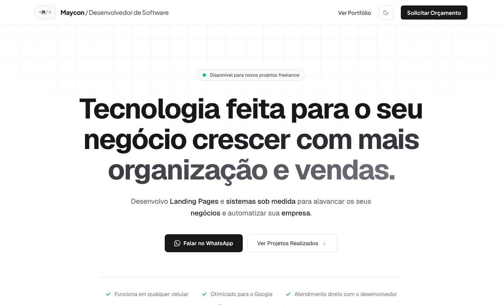
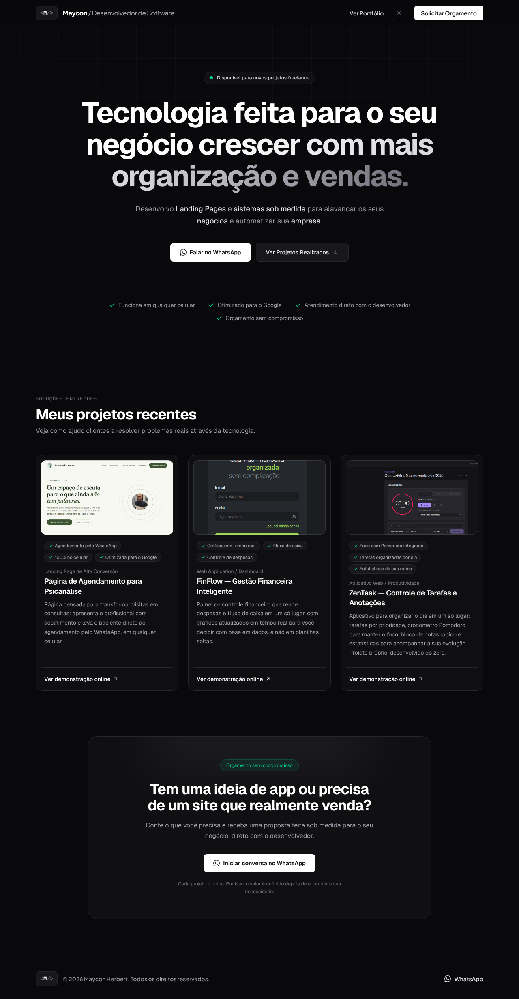
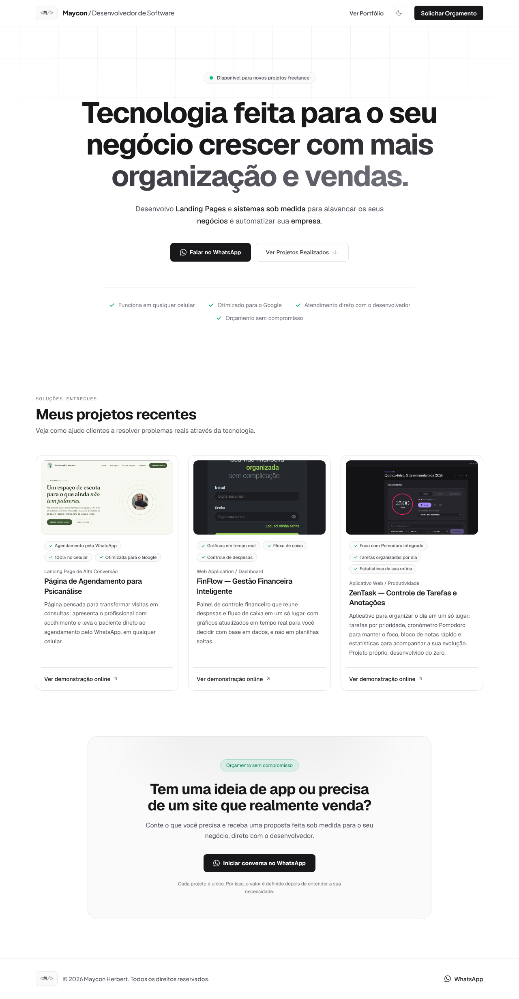

<div align="center">

# `<M/>` Maycon — Portfólio

**Landing page de vendas e portfólio para serviços de desenvolvimento de sites e sistemas sob medida.**


<!-- Quando publicar na Vercel, descomente e troque o endereço:
[**Ver site online →**](https://SEU-SITE.vercel.app)
-->

<br />


</div>

<br />

## Sobre o projeto

Um site direto ao ponto para apresentar o meu trabalho a quem precisa de um site que venda ou de um sistema feito sob medida. A página leva o visitante do **problema** (o que ele precisa) à **prova** (projetos reais no ar) e termina em uma **conversa no WhatsApp**, sem formulários no caminho.

O visual segue a linha *Clean Tech*: minimalista, com bastante respiro, tipografia forte e foco no conteúdo.

## Destaques

- **Modo claro e escuro**: o tema escolhido fica salvo no navegador e é aplicado antes da página aparecer, sem piscar.
- **100% responsivo**: pensado primeiro para o celular, onde está a maior parte dos clientes.
- **Projetos orientados por dados**: os cartões são gerados a partir de uma lista tipada. Para adicionar um projeto, basta incluir um item.
- **Chamada para ação com WhatsApp**: botões com mensagem pré-preenchida, para o cliente começar a conversa em um toque.
- **Animações discretas**: entrada em sequência e surgimento ao rolar a página. Quem prefere menos movimento no sistema não vê as animações.
- **Base de SEO**: idioma `pt-BR`, título e descrição configurados, textos alternativos nas imagens.
- **Sem dependências desnecessárias**: ícones em SVG próprio e animações em CSS puro.

## Prévia

<table>
  <tr>
    <td align="center"><b>Modo escuro</b></td>
    <td align="center"><b>Modo claro</b></td>
  </tr>
  <tr>
    <td></td>
    <td></td>
  </tr>
</table>

<details>
<summary><b>Ver a página completa</b></summary>
<br />

<table>
  <tr>
    <td></td>
    <td></td>
  </tr>
</table>

</details>

## Tecnologias

| Camada | Escolha |
|---|---|
| Interface | React 19 + TypeScript |
| Build e servidor de desenvolvimento | Vite |
| Estilos | Tailwind CSS 4 |
| Fontes | Geist (corpo) e Plus Jakarta Sans (cabeçalho e rodapé) |
| Hospedagem | Vercel |

## Estrutura

```
src/
├─ componentes/
│  ├─ Cabecalho.tsx        # barra superior com logo, tema e botão de orçamento
│  ├─ Hero.tsx             # título, botões e selos de confiança
│  ├─ Projetos.tsx         # seção que monta a lista de cartões
│  ├─ CartaoProjeto.tsx    # cartão de um projeto
│  ├─ BannerFinal.tsx      # chamada final para o WhatsApp
│  ├─ Rodape.tsx
│  ├─ BotaoTema.tsx        # alternar claro/escuro
│  ├─ Logo.tsx             # a marca <M/>
│  ├─ Revelar.tsx          # surgir ao rolar a página
│  └─ Icones.tsx           # ícones em SVG
├─ dados/
│  └─ projetos.ts          # lista de projetos exibidos
├─ lib/
│  ├─ contato.ts           # número e mensagem do WhatsApp
│  └─ useTema.ts           # lógica do modo claro/escuro
├─ App.tsx
├─ main.tsx
└─ index.css               # Tailwind, tema e animações
public/
└─ projetos/               # prints dos projetos
```

## Como rodar

Pré-requisito: [Node.js](https://nodejs.org) 20.19 ou superior.

```bash
# 1. clonar o repositório
git clone https://github.com/MayconH94/maycon.git
cd maycon

# 2. instalar as dependências
npm install

# 3. iniciar em modo de desenvolvimento
npm run dev
```

O site abre em `http://localhost:5190`.

| Comando | O que faz |
|---|---|
| `npm run dev` | Inicia o servidor de desenvolvimento |
| `npm run build` | Confere os tipos e gera a versão final em `dist/` |
| `npm run preview` | Abre a versão final localmente para testar |
| `npm run lint` | Procura problemas no código |

## Como personalizar

**Contato.** Em `src/lib/contato.ts`, troque o número (com DDI e DDD, só dígitos) e a mensagem inicial do WhatsApp. Todos os botões do site usam esse arquivo.

**Projetos.** Em `src/dados/projetos.ts`, cada projeto segue este formato:

```ts
{
  titulo: 'Nome do projeto',
  categoria: 'Tipo de projeto',
  descricao: 'O que ele resolve para o cliente.',
  beneficios: ['Benefício 1', 'Benefício 2', 'Benefício 3'],
  imagem: '/projetos/nome-do-print.png', // arquivo em public/projetos
  linkDemo: 'https://endereco-do-projeto.com', // opcional
}
```

Sem `linkDemo`, o cartão mostra "Demonstração em breve". O ideal é que os prints tenham proporção 16:9.

**Textos e cores.** Os textos estão nos próprios componentes, e as cores são classes do Tailwind (paleta `zinc`, com verde nos detalhes de confiança).

## Publicação

O projeto está pronto para a [Vercel](https://vercel.com): importe o repositório e mantenha as opções detectadas automaticamente (framework **Vite**, comando `npm run build`, pasta de saída `dist`). A cada `git push`, o site é atualizado.

## Contato

Fale comigo pelo botão de WhatsApp do site ou me encontre aqui no GitHub: [@MayconH94](https://github.com/MayconH94).

<br />

<div align="center">

© 2026 Maycon Herbert. Todos os direitos reservados.

</div>
